# 🛡️ NGFW-Enhanced Wazuh SOC Homelab: Suricata IDS & OpenVPN Anomaly Detection

[](https://wazuh.com/)
[](https://suricata.io/)
[](https://openvpn.net/)
[](https://attack.mitre.org/)
[](#)

> **Timeline:** January 2026 – Present  
> **Role Focus:** Tier 1 / Tier 2 SOC Analyst · Detection Engineering · Network Security Monitoring (NSM)

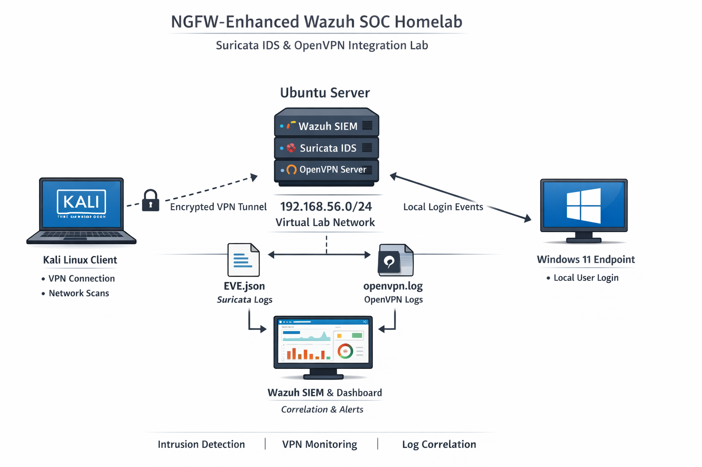

---

## 📋 Executive Summary

Modern Security Operations Centers (SOCs) cannot rely solely on endpoint telemetry; detecting credential abuse and lateral movement requires correlating **host-level events** with **network-layer visibility**. 

This project extends my core [Wazuh Endpoint SOC Homelab](https://github.com/nimesh895/wazuh-soc-homelab) by engineering a **Next-Generation Firewall (NGFW) & Network Security Monitoring (NSM)** pipeline using open-source technologies. By integrating **Suricata IDS** for deep packet inspection (EVE JSON) and **OpenVPN** for remote access telemetry into **Wazuh SIEM**, this lab detects multi-stage anomalies such as **Impossible Travel / Concurrent Session Abuse** (e.g., the same user authenticating via VPN and locally within a 5-minute window) and active network reconnaissance.

---

## 🎯 Key Engineering & SOC Achievements

- **Multi-Source SIEM Ingestion:** Engineered centralized log collection in Wazuh (`/var/ossec/etc/ossec.conf`) by ingesting structured **Suricata EVE JSON** telemetry (`http`, `dns`, `tls`, `alert`) alongside **OpenVPN syslog** streams and **Windows 11 Event Logs**.
- **Custom Detection Engineering:** Authored custom XML correlation rules in Wazuh (`/var/ossec/etc/rules/local_rules.xml`) utilizing `frequency`, `timeframe`, and `<same_user>` directives to detect rapid multi-vector authentication anomalies within a **300-second window**.
- **Network Intrusion Detection (NIDS):** Deployed **Suricata 7.0.3** using `af-packet` zero-copy capture on an isolated promiscuous network (`192.168.56.0/24`) to inspect east-west and north-south traffic in real time.
- **Hardened PKI & VPN Infrastructure:** Built a custom Certificate Authority (CA) with **Easy-RSA**, enforcing **SHA-256** cryptographic digests, **2048-bit Diffie-Hellman** parameters, and **TLS-Auth (`ta.key`)** HMAC protection to mitigate DoS and TLS handshake scanning.
- **Safe Adversary Simulation:** Validated detection efficacy from an isolated **Kali Linux** node by simulating VPN tunnel establishment, concurrent credential usage, and network service discovery scans.

---

## 🗺️ MITRE ATT&CK® Coverage

| Tactic | Technique ID | Technique Name | Telemetry Source | Detection Mechanism |
| :--- | :--- | :--- | :--- | :--- |
| **Initial Access / Persistence** | `T1078` | **Valid Accounts** | OpenVPN (`openvpn.log`) + Windows Security Events | Custom Wazuh composite correlation rules (`ID 100002` – `100004`) flagging concurrent/impossible travel logins within 5 minutes. |
| **Initial Access** | `T1133` | **External Remote Services** | OpenVPN (`openvpn.log`) | Real-time tracking of VPN tunnel establishment, certificate validation, and repeated authentication failures. |
| **Discovery** | `T1046` | **Network Service Discovery** | Suricata (`eve.json`) | Emerging Threats (ET) ruleset inspecting `enp0s8` in promiscuous mode for Nmap/reconnaissance signatures. |
| **Credential Access** | `T1110` | **Brute Force** | Windows Event ID `4625` + OpenVPN | High-severity alerting (`Level 10`) on repeated failed logons mapped to PCI-DSS `10.2.4` & `10.2.5`. |

---

## 🏗️ Lab Architecture & Telemetry Pipeline

### Environment Topology

| Node | OS / Platform | Role & Services | Network Segment |
| :--- | :--- | :--- | :--- |
| **Security Sensor & SIEM** | Ubuntu Server | Wazuh Manager, Suricata 7.0.3 IDS, OpenVPN Server, Easy-RSA CA | `192.168.56.0/24` (`enp0s8` – Promiscuous Mode) |
| **Monitored Endpoint** | Windows 11 | Corporate Workstation with Wazuh Agent | `192.168.56.0/24` (Host-Only Isolated) |
| **Adversary / Remote Client** | Kali Linux | Remote VPN Client & Attack Simulation Node | `192.168.56.0/24` + Tunneled VPN Route |

### Data Flow Architecture

```text
[Kali Linux: VPN Client & Scanner] ══════ (Encrypted OpenVPN Tunnel / Recon Scans) ══════► [Windows 11 Endpoint]
               │                                                                                    │
               ▼ (Network Traffic / Promiscuous Capture)                                            ▼ (Host Telemetry)
┌───────────────────────────────────────────────────────────────────────────────────┐      ┌─────────────────┐
│ Ubuntu Security Server                                                            │      │   Wazuh Agent   │
│  ├─ Suricata 7.0.3 (af-packet: enp0s8) ──► /var/log/suricata/eve.json (JSON) ─────┼─────►│   Event Logs    │
│  └─ OpenVPN Server (TLS-Auth / SHA256) ──► /var/log/openvpn.log (Syslog) ─────────┼──┐   └────────┬────────┘
└───────────────────────────────────────────────────────────────────────────────────┘  │            │
                                                                                       ▼            ▼
                                                                             ┌────────────────────────────────┐
                                                                             │     Wazuh SIEM Manager         │
                                                                             │  • Decoders & Normalization    │
                                                                             │  • Custom Correlation Rules    │
                                                                             │  • SOC Alerting & Triage       │
                                                                             └────────────────────────────────┘
```

---

## 🔧 Technical Implementation Walkthrough

### Phase 1: Suricata NIDS Deployment & Packet Capture Configuration

Configured **Suricata 7.0.3** for passive network traffic inspection across the lab subnet (`192.168.56.0/24`) using `af-packet` on interface `enp0s8`, outputting rich application-layer metadata (`http`, `dns`, `tls`, `alerts`) in `eve.json`.

<details>
<summary><b>📸 View Step-by-Step Suricata Configuration Screenshots (Click to Expand)</b></summary>
<br>

**1. Install Suricata & JSON Processor (`jq`)**  
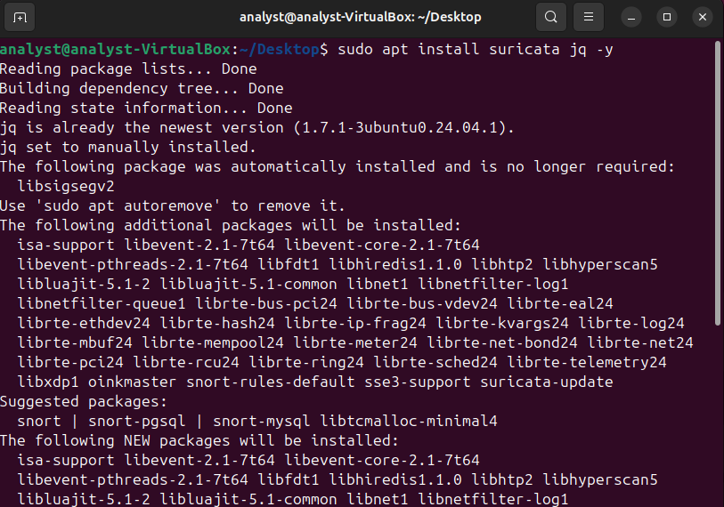

**2. Update Emerging Threats (ET) Signatures (`suricata-update`)**  
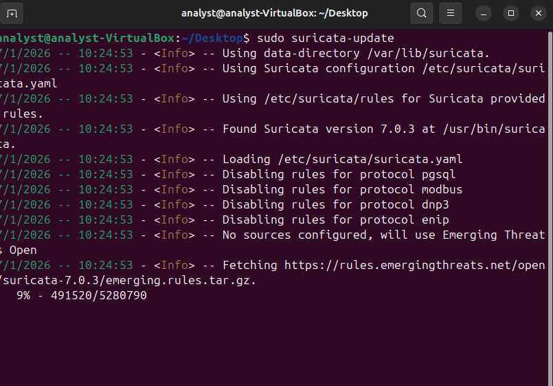

**3. Open Suricata Configuration (`/etc/suricata/suricata.yaml`)**  
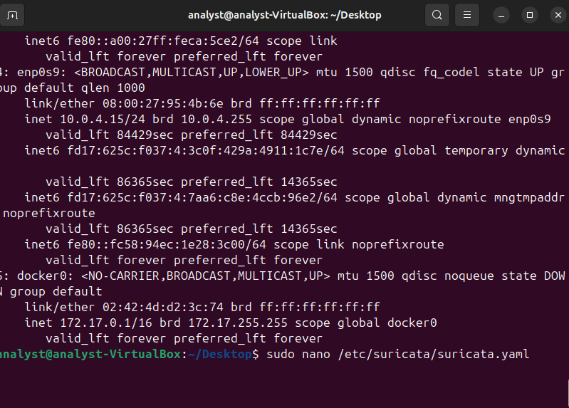

**4. Bind `af-packet` Capture Interface to `enp0s8`**  
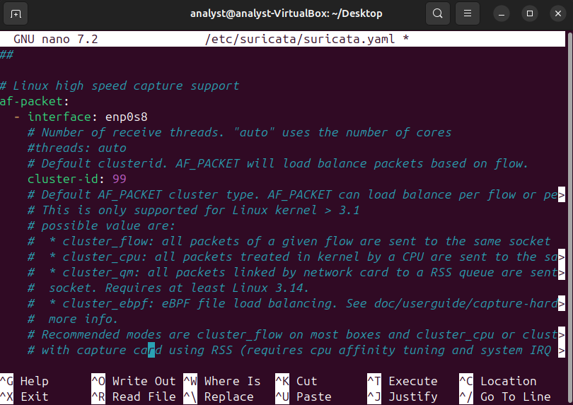

**5. Scope `HOME_NET` to Lab Subnet (`192.168.56.0/24`)**  
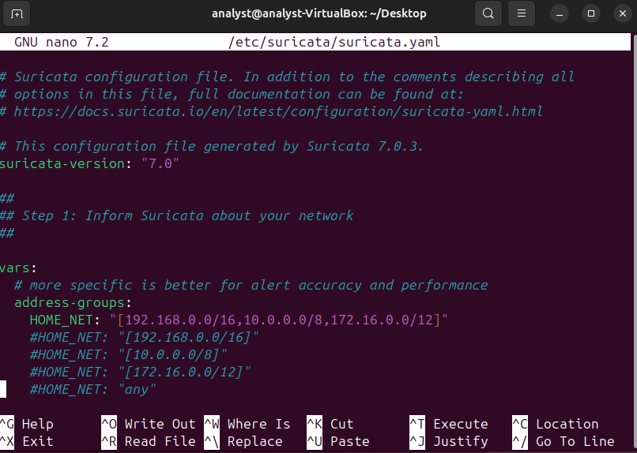

**6. Enable EVE JSON Telemetry Output**  
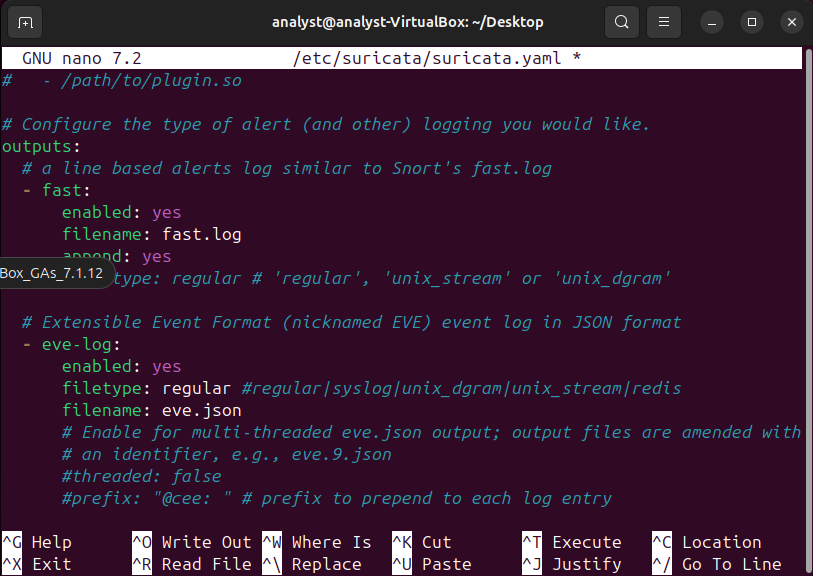

**7. Start & Verify Suricata Service**  
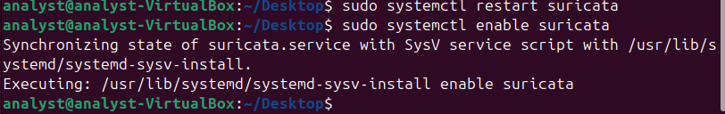
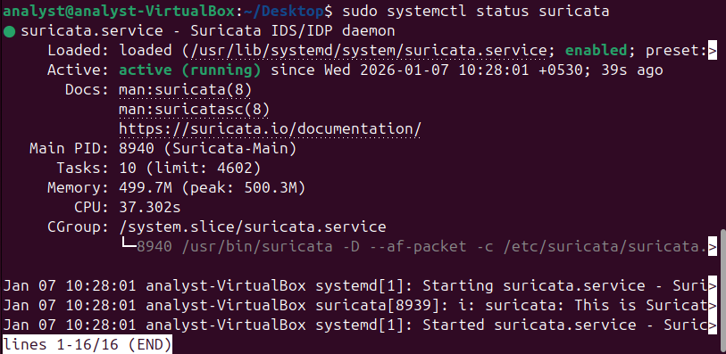

</details>

---

### Phase 2: Hardened OpenVPN Server & PKI Infrastructure

Deployed an **OpenVPN** server backed by an **Easy-RSA** Public Key Infrastructure (PKI). Enforced strong cryptographic baselines (**SHA-256** signature digest, **2048-bit DH** parameters, and **TLS-Auth** HMAC keys) and configured internal route pushing (`192.168.56.0/24`) to monitor client access.

<details>
<summary><b>📸 View Step-by-Step OpenVPN & PKI Setup Screenshots (Click to Expand)</b></summary>
<br>

**1. Install OpenVPN & Easy-RSA**  
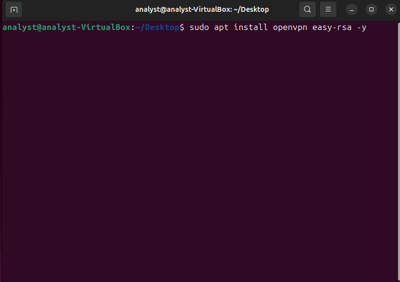

**2. Initialize PKI Directory (`make-cadir ~/openvpn-ca`)**  
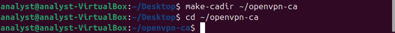

**3. Configure Certificate Authority Variables (`vars` with SHA-256 & Organizational Metadata)**  
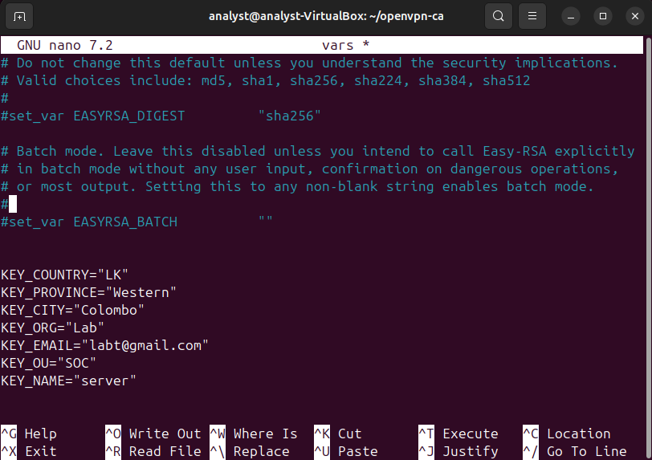

**4. Generate CA, Server/Client Certificates, 2048-bit DH Parameters, and `ta.key`**  
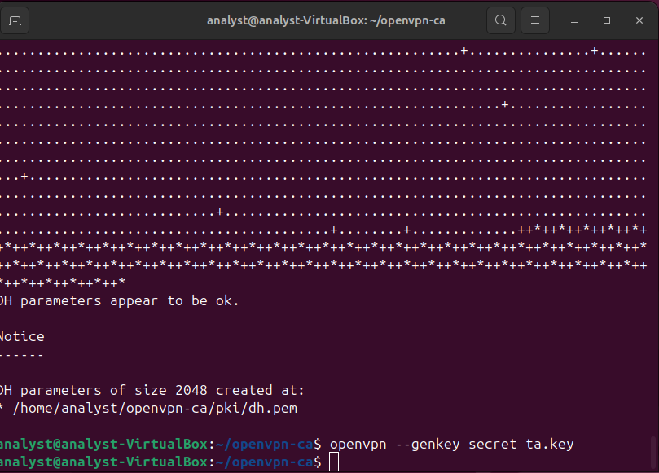

**5. Configure OpenVPN Server & Route Pushing (`/etc/openvpn/server/server.conf`)**  
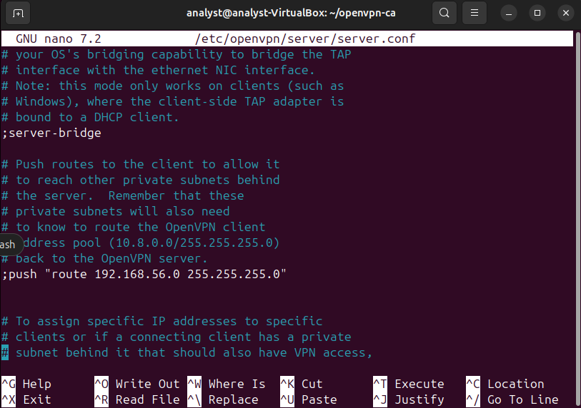

**6. Verify OpenVPN Daemon Status**  
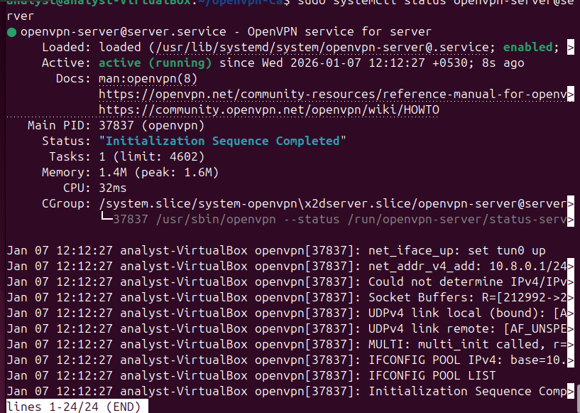

</details>

---

### Phase 3: SIEM Log Ingestion & Normalization (`ossec.conf`)

Integrated both network sensors into Wazuh by defining `<localfile>` ingestion blocks in `/var/ossec/etc/ossec.conf`:

```xml
<!-- Suricata NIDS EVE JSON Telemetry -->
<localfile>
  <log_format>json</log_format>
  <location>/var/log/suricata/eve.json</location>
</localfile>

<!-- OpenVPN Authentication & Session Syslog -->
<localfile>
  <log_format>syslog</log_format>
  <location>/var/log/openvpn.log</location>
</localfile>
```

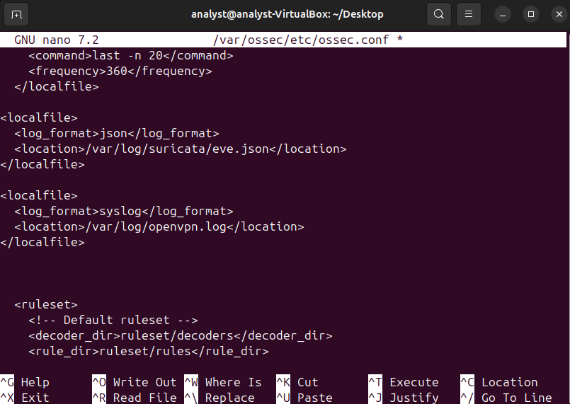

<details>
<summary><b>📸 View Wazuh Service Restart Verification</b></summary>
<br>

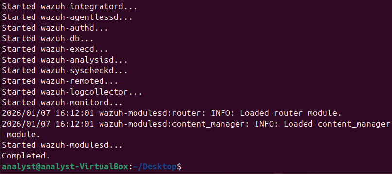

</details>

---

### Phase 4: Custom Detection Engineering & Correlation Rules (`local_rules.xml`)

To detect credential misuse and impossible travel scenarios, I authored custom correlation rules in `/var/ossec/etc/rules/local_rules.xml`. These rules track baseline VPN authentications (`Rule 100002`) and escalate to high-severity alerts (`Level 10`) when multiple rapid VPN events or concurrent VPN + local logins occur for the same user within **5 minutes (300 seconds)**:

```xml
<group name="vpn_local">
  <!-- Baseline Detection: Successful OpenVPN Client Connection -->
  <rule id="100002" level="5">
    <if_group>openvpn</if_group>
    <match>connected</match>
    <description>VPN user connected</description>
  </rule>

  <!-- Frequency Correlation: Multiple VPN Events by Same User in 5 Minutes -->
  <rule id="100003" level="10" frequency="2" timeframe="300">
    <if_matched_sid>100002</if_matched_sid>
    <same_user>yes</same_user>
    <description>Multiple VPN-related events by same user within 5 minutes</description>
  </rule>

  <!-- Anomaly Detection: Impossible Travel / Concurrent VPN + Local Login -->
  <rule id="100004" level="10">
    <if_group>openvpn</if_group>
    <match>connected</match>
    <same_user>yes</same_user>
    <time>300</time>
    <description>VPN + Local Login in 5min (Impossible Travel)</description>
  </rule>
</group>
```

#### Detection Rule Verification Screenshots
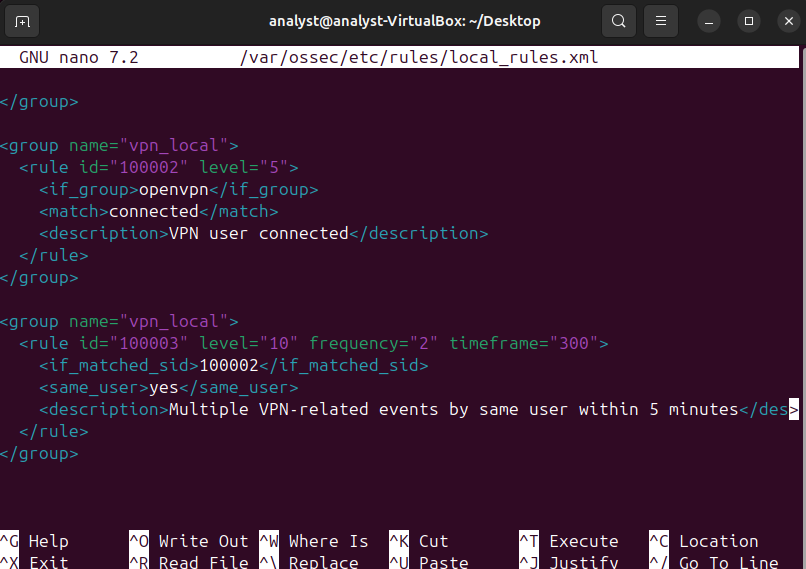

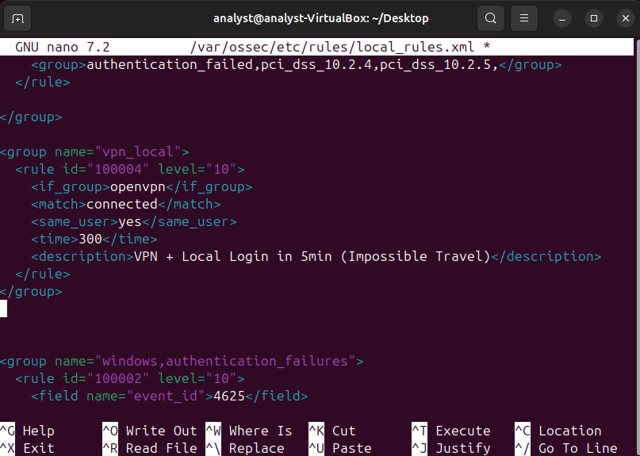

---

## 🧪 Testing, Validation & Future Roadmap

### Attack Simulation & Validation
1. **Concurrent Session / Impossible Travel Simulation:** Initiated an OpenVPN tunnel from the Kali Linux node while simultaneously performing a local Windows 11 authentication under the same user identity inside a 5-minute window, validating high-priority (`Level 10`) alert generation.
2. **Network Reconnaissance Detection:** Executed active port and service discovery scans across `192.168.56.0/24`, verifying that Suricata captured the traffic on `enp0s8`, logged alerts to `eve.json`, and surfaced them in the Wazuh dashboard.

### Future Engineering Roadmap
- **GeoIP Enrichment:** Integrate MaxMind GeoIP decoders into Wazuh to calculate physical distance velocity between source public IPs and corporate logins.
- **Active Response Automation:** Configure Wazuh Active Response scripts to automatically revoke or drop suspicious OpenVPN client sessions upon triggering `Rule 100004`.
- **Alert Tuning:** Baseline normal administrative traffic to suppress benign false positives during routine maintenance windows.

---

## 💼 Core Competencies Demonstrated

| Domain | Practical Skills Applied |
| :--- | :--- |
| **SIEM & Log Management** | Multi-format log ingestion (`JSON`, `syslog`, Windows Event Channel), decoder mapping, service management |
| **Detection Engineering** | Custom XML rule authoring, stateful event correlation (`frequency`, `timeframe`, `same_user`), MITRE ATT&CK alignment |
| **Network Security (NSM)** | Suricata NIDS deployment, `af-packet` promiscuous capture, Emerging Threats (ET) rule management, EVE JSON analysis |
| **Cryptography & Access Control** | Easy-RSA PKI administration, X.509 certificate lifecycle, SHA-256 / DH-2048 / TLS-Auth VPN hardening |
| **Systems Administration** | Ubuntu Server CLI administration, VirtualBox isolated virtual networking, systemd service troubleshooting |

---

## 🔗 Related Security Engineering Projects

- 🛡️ **[Core Wazuh SOC Homelab – Endpoint Monitoring](https://github.com/nimesh895/wazuh-soc-homelab)** *(May 2025 – Present)* — Foundational SIEM deployment focusing on host-based intrusion detection, FIM, and endpoint telemetry.
- ☁️ **[Azure Security Monitoring Lab](https://github.com/nimesh895/azure-security-monitoring-lab)** *(Jan 2026 – Present)* — Cloud-native security monitoring, SIEM integration, and threat detection in Microsoft Azure.

---

## 📬 Contact & Connect

I am actively seeking **Tier 1 SOC Analyst**, **Security Operations**, or **Cybersecurity Internship** opportunities where I can contribute hands-on detection and triage skills. Feel free to reach out!

- **LinkedIn:** [linkedin.com/in/nimesh23](https://linkedin.com/in/nimesh23)
- **GitHub:** [github.com/nimesh895](https://github.com/nimesh895)
